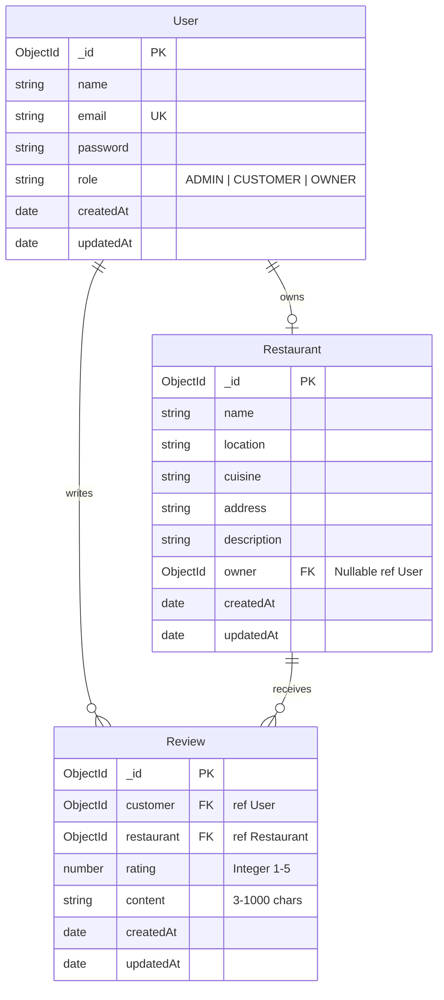

# SmartWinnr Restaurant Rating & Review Platform

A production-grade, full-stack MERN application developed for the SmartWinnr technical assessment. The platform enables dining customers to discover restaurants, read community feedback, and submit verified reviews under strict architectural guarantees, while providing dedicated management portals for restaurant owners and platform administrators.

---

## 1. Project Overview

The SmartWinnr Restaurant Rating & Review Platform is designed around authentic culinary discovery and review integrity. Unlike trivial tutorial applications, this system enforces critical business rules at both the application and database layers:

- **Strict One-Review-Per-Customer Integrity:** A customer can submit only one review per restaurant. Repeated reviews are blocked by both Express controller checks and a MongoDB compound unique index `{ customer: 1, restaurant: 1 }`.
- **Pure MongoDB Aggregation Pipelines:** Average ratings, total counts, platform metrics, and 5-to-1 star rating distributions are calculated directly from persistent database documents via native MongoDB aggregation stages (`$match`, `$group`, `$sort`), never through superficial client-side averages.
- **Three Distinct Role Workflows:** Role-based access control (RBAC) cryptographically backed by JWT with independent experiences for Diners (`CUSTOMER`), Proprietors (`OWNER`), and Administrators (`ADMIN`).
- **Editorial UI/UX Aesthetics:** An editorial design system utilizing warm off-white tones, deep charcoal typography, forest green primary accents, and terracotta badges with responsive layouts and accessible micro-interactions.

---

## 2. Key Features

### A. Customer Role (`CUSTOMER`)
- **Public & Authenticated Discovery:** Browse curated dining establishments with real-time backend query search by name (`?search=`), city/location filter (`?location=`), and cuisine filter (`?cuisine=`).
- **Personal Review Enrichment:** Listing cards indicate whether the currently logged-in customer has already reviewed a restaurant and what rating they provided.
- **Restaurant Details & Rating Distributions:** View detailed descriptions, street address, aggregated average rating, total review count, and full 5-star distribution bars. Displays `"No ratings yet"` when a restaurant has zero reviews.
- **Review Submission & Editing:** Interactive accessible 1–5 star picker with written feedback. Customers can edit or delete their own review.
- **My Reviews Console:** Dedicated customer dashboard displaying all submitted reviews with direct links to restaurants and management controls.

### B. Restaurant Owner Role (`OWNER`)
- **Proprietor Console:** Isolated dashboard mapped to the owner's assigned restaurant via authenticated JWT identity (`req.user._id`), never trusting client-supplied IDs.
- **Live Restaurant Performance:** Real-time visibility into the assigned restaurant's average rating, total reviews, and 5-to-1 star breakdown.
- **Customer Feedback Stream:** Full customer review history displaying reviewer names, submitted ratings, and dates.
- **Permitted Detail Updates:** Proprietors can update allowed restaurant details (name, location, cuisine, address, description) while strictly prohibited from modifying ownership assignments or altering customer reviews.

### C. Administrator Role (`ADMIN`)
- **Platform Governance Dashboard:** Real-time platform metrics aggregated across the entire database:
  - Total registered users (broken down by role).
  - Total restaurants in the directory.
  - Total verified reviews across all venues.
  - Platform-wide average rating calculated across all review documents.
  - Global rating distribution.
- **User Account Management:** Search and filter users by role. Update user roles with safeguards preventing self-demotion or self-deletion of the active administrator.
- **Restaurant Owner Provisioning:** Create verified restaurant owner accounts and link them directly to dining establishments.
- **Restaurant Catalog Management:** Create new venues, modify details, assign/reassign owners, and delete venues (with automatic cascading cleanup of associated reviews).
- **Review Moderation:** View all platform reviews and permanently delete inappropriate content, automatically triggering metric recalculation.

---

## 3. Technology Stack

| Layer | Technologies |
| :--- | :--- |
| **Frontend** | React 18, Vite 6, React Router DOM 6, Axios, Lucide React Icons |
| **Backend** | Node.js (v24), Express.js 4, Morgan, CORS, Dotenv |
| **Database & ODM** | MongoDB 7.0 (WiredTiger Engine), Mongoose 8.9 |
| **Authentication** | JSON Web Tokens (`jsonwebtoken`), `bcryptjs` (salt work factor 10) |
| **Styling** | Custom CSS Editorial System (Google Fonts: Playfair Display & Plus Jakarta Sans) |
| **API Testing** | Node HTTP Test Runner, Postman Collection v2.1 |

---

## 4. Project Structure

```text
SMARTWINNR RESTAURANT RATING & REVIEW PLATFORM/
├── package.json                         # Root package scripts (server, client, seed, test)
├── .env.example                         # Example environment configuration
├── .gitignore                           # Git exclusion rules
├── SmartWinnr Restaurant Rating Platform.postman_collection.json # Exported Postman suite
├── README.md                            # Comprehensive documentation
│
├── server/                              # Express backend application
│   ├── config/
│   │   └── db.js                        # Mongoose connection & MongoDB daemon management
│   ├── models/
│   │   ├── User.js                      # User schema with bcrypt hooks & safe JSON serialization
│   │   ├── Restaurant.js                # Restaurant schema with search & location indexes
│   │   └── Review.js                    # Review schema with compound unique index
│   ├── controllers/
│   │   ├── authController.js            # Registration, login, current profile (me)
│   │   ├── restaurantController.js      # Search, filtering, details, stats enrichment
│   │   ├── reviewController.js          # Review CRUD & compound unique error handling
│   │   ├── ownerController.js           # Proprietor restaurant metrics & review history
│   │   └── adminController.js           # Platform aggregation, user & restaurant management
│   ├── routes/
│   │   ├── authRoutes.js
│   │   ├── restaurantRoutes.js
│   │   ├── reviewRoutes.js
│   │   ├── ownerRoutes.js
│   │   └── adminRoutes.js
│   ├── middleware/
│   │   ├── authMiddleware.js            # JWT verification & req.user attachment
│   │   ├── roleMiddleware.js            # Role-based authorization guard
│   │   └── errorMiddleware.js           # Centralized error handler & Cast/E11000 translation
│   ├── validators/
│   │   ├── authValidators.js            # Password strength (8-16 chars, upper, lower, num, spec)
│   │   ├── restaurantValidators.js      # Restaurant field boundaries
│   │   └── reviewValidators.js          # Integer 1-5 rating & text content validation
│   ├── utils/
│   │   ├── asyncHandler.js              # Express async error wrapper
│   │   ├── generateToken.js             # JWT token generator
│   │   └── aggregations.js              # Reusable MongoDB aggregation pipelines
│   ├── scripts/
│   │   ├── seedAdmin.js                 # Idempotent administrator seed script
│   │   ├── seedDemo.js                  # Comprehensive demo seed script
│   │   └── testPlatform.js              # 38-assertion automated test suite
│   ├── app.js                           # Express application configuration
│   └── server.js                        # Server entry point
│
└── client/                              # React + Vite frontend application
    ├── index.html                       # Entry HTML with typography fonts
    ├── vite.config.js                   # Vite dev server configuration
    ├── package.json                     # Frontend dependencies
    └── src/
        ├── components/
        │   ├── Navbar.jsx               # Role-aware responsive navigation
        │   ├── Footer.jsx               # Editorial footer with platform standards
        │   ├── RestaurantCard.jsx       # Card displaying cuisine, rating, and user badge
        │   ├── RatingStars.jsx          # Accessible interactive & read-only star component
        │   ├── RatingDistribution.jsx   # 5-to-1 star bar progress visualization
        │   ├── ReviewCard.jsx           # Review card with verified author & action buttons
        │   ├── ReviewForm.jsx           # Review submission/edit form with live validation
        │   ├── SearchBar.jsx            # Backend search input with clear trigger
        │   ├── FilterPanel.jsx          # Location and cuisine dropdown filters
        │   ├── ProtectedRoute.jsx       # Client-side session and role guard
        │   ├── LoadingState.jsx         # Accessible loading indicator
        │   ├── ErrorState.jsx           # Error state with retry action
        │   └── ConfirmDialog.jsx        # Accessible modal confirmation for destructive actions
        ├── context/
        │   └── AuthContext.jsx          # Centralized authentication & session state
        ├── layouts/
        │   ├── MainLayout.jsx           # Public & customer layout
        │   └── DashboardLayout.jsx      # Admin & Owner portal layout with sub-navigation
        ├── pages/
        │   ├── Home.jsx                 # Editorial landing page
        │   ├── Restaurants.jsx          # Discover page with filters & pagination
        │   ├── RestaurantDetails.jsx    # Restaurant profile, reviews, and submission form
        │   ├── Login.jsx                # Login form with one-click demo credentials
        │   ├── Register.jsx             # Customer registration (strictly CUSTOMER role)
        │   ├── MyReviews.jsx            # Customer's personal reviews console
        │   ├── CustomerDashboard.jsx    # Customer profile overview & stats
        │   ├── OwnerDashboard.jsx       # Owner restaurant console & analytics
        │   ├── AdminDashboard.jsx       # Admin overview with real MongoDB statistics
        │   ├── ManageUsers.jsx          # Admin user management & owner creation
        │   ├── ManageRestaurants.jsx    # Admin restaurant catalog & owner assignment
        │   └── ManageReviews.jsx        # Admin review moderation
        ├── services/
        │   └── api.js                   # Axios client with JWT interceptors
        ├── styles/
        │   └── index.css                # Editorial CSS variables & component styles
        ├── App.jsx                      # Route definitions
        └── main.jsx                     # React root mount
```

---

## 5. Database Architecture & Design

The platform uses MongoDB with Mongoose ODM structured into three relational collections:



### Critical Compound Unique Index
To prevent review inflation and ensure each verified diner submits only one review per restaurant, the Review model enforces a compound unique index:
```javascript
reviewSchema.index({ customer: 1, restaurant: 1 }, { unique: true });
```
When a duplicate review is attempted, MongoDB triggers error `E11000`, which our centralized error middleware catches and translates into HTTP `409 Conflict`:
```json
{
  "success": false,
  "message": "You have already reviewed this restaurant."
}
```

---

## 6. Authentication and Security

- **Password Hashing:** Passwords are never stored in plain text. Pre-save Mongoose hooks hash passwords using `bcryptjs` with 10 salt rounds (`isModified('password')` prevents rehashing on profile edits).
- **Password Strength Criteria:** Enforces 8–16 characters, containing at least one uppercase letter, one lowercase letter, one numeric digit, and one special character (`[!@#$%^&*()_+\-=\[\]{};':"\\|,.<>/?]`).
- **Cryptographic JWT:** Signed with `JWT_SECRET` containing `{ id, role }`, expiring in 7 days.
- **Protected Deserialization:** The User model implements a custom `toJSON()` method that strips `password` from all API responses.
- **Public Registration Isolation:** Public registration (`POST /api/auth/register`) strictly sets `role: "CUSTOMER"`. Requests attempting to submit `"role": "ADMIN"` or `"role": "OWNER"` are ignored.
- **Admin Self-Deletion Safeguard:** The user deletion endpoint explicitly prevents administrators from accidentally deleting their own active account.

---

## 7. MongoDB Aggregation Pipelines

### A. Restaurant Average & Review Count
```javascript
[
  { $match: { restaurant: new mongoose.Types.ObjectId(restaurantId) } },
  {
    $group: {
      _id: "$restaurant",
      averageRating: { $avg: "$rating" },
      totalReviews: { $sum: 1 }
    }
  }
]
```
If a restaurant has no reviews, the API returns `{ averageRating: null, totalReviews: 0 }`, and the UI displays `"No ratings yet"`.

### B. Rating Distribution (5 Stars to 1 Star)
```javascript
[
  { $match: { restaurant: new mongoose.Types.ObjectId(restaurantId) } },
  { $group: { _id: "$rating", count: { $sum: 1 } } },
  { $sort: { _id: -1 } }
]
```
The helper normalizes the output to ensure all five categories (`5`, `4`, `3`, `2`, `1`) are present, filling zero-count categories automatically:
```json
{ "5": 1, "4": 2, "3": 0, "2": 0, "1": 0 }
```

### C. Admin Platform-Wide Average
Calculated across all review records directly—**never by averaging restaurant averages**:
```javascript
[
  {
    $group: {
      _id: null,
      averagePlatformRating: { $avg: "$rating" }
    }
  }
]
```

---

## 8. REST API Reference

### Authentication Routes
| Method | Endpoint | Access | Description |
| :--- | :--- | :--- | :--- |
| `POST` | `/api/auth/register` | Public | Register customer account (strictly `CUSTOMER`) |
| `POST` | `/api/auth/login` | Public | Authenticate user & return JWT |
| `GET` | `/api/auth/me` | Authenticated | Retrieve authenticated user profile |

### Restaurant Discovery Routes
| Method | Endpoint | Access | Description |
| :--- | :--- | :--- | :--- |
| `GET` | `/api/restaurants` | Public | List restaurants with search, location/cuisine filters |
| `GET` | `/api/restaurants/:id` | Public | Get restaurant details, aggregated stats, & reviews |
| `GET` | `/api/restaurants/:id/reviews` | Public | Get all reviews for a specific restaurant |
| `POST` | `/api/restaurants/:id/reviews`| Customer | Submit a new review (1 review per restaurant limit) |

### Customer Review Routes
| Method | Endpoint | Access | Description |
| :--- | :--- | :--- | :--- |
| `GET` | `/api/reviews/me` | Customer | Get all reviews submitted by the current user |
| `PATCH` | `/api/reviews/:id` | Customer (Author) | Update own review rating and content |
| `DELETE`| `/api/reviews/:id` | Customer (Author) | Delete own review |

### Restaurant Owner Routes
| Method | Endpoint | Access | Description |
| :--- | :--- | :--- | :--- |
| `GET` | `/api/owner/restaurant` | Owner | Retrieve assigned restaurant & analytics |
| `PATCH` | `/api/owner/restaurant` | Owner | Update permitted restaurant details |
| `GET` | `/api/owner/restaurant/reviews` | Owner | List customer reviews for assigned restaurant |
| `GET` | `/api/owner/restaurant/analytics` | Owner | Detailed performance analytics |

### Administrator Routes
| Method | Endpoint | Access | Description |
| :--- | :--- | :--- | :--- |
| `GET` | `/api/admin/dashboard` | Admin | Real-time platform metrics via MongoDB aggregation |
| `GET` | `/api/admin/users` | Admin | Search & filter users by role |
| `PATCH` | `/api/admin/users/:id` | Admin | Update user role |
| `DELETE`| `/api/admin/users/:id` | Admin | Delete user account (with self-deletion guard) |
| `POST` | `/api/admin/owners` | Admin | Create Restaurant Owner account |
| `GET` | `/api/admin/restaurants` | Admin | List all restaurants with management data |
| `POST` | `/api/admin/restaurants` | Admin | Create a new restaurant & assign owner |
| `PATCH` | `/api/admin/restaurants/:id` | Admin | Update restaurant details or reassign owner |
| `DELETE`| `/api/admin/restaurants/:id` | Admin | Delete restaurant (cascades review cleanup) |
| `GET` | `/api/admin/reviews` | Admin | View all reviews across platform |
| `DELETE`| `/api/admin/reviews/:id` | Admin | Delete inappropriate review |

---

## 9. Sample Login Credentials

All sample credentials below are pre-seeded in the database:

| Role | Name | Email | Password | Assigned Entity |
| :--- | :--- | :--- | :--- | :--- |
| **Administrator** | Platform Administrator | `admin@smartwinnr.com` | `Admin@12345` | Platform-wide governance |
| **Restaurant Owner** | Chef Rajesh Verma | `owner.spice@smartwinnr.com` | `Owner@12345` | Spice Symphony (Hyderabad) |
| **Restaurant Owner** | Marco Bellini | `owner.tuscany@smartwinnr.com` | `Owner@12345` | Trattoria Da Tuscany (Bangalore) |
| **Customer** | Priya Sharma | `priya.customer@smartwinnr.com` | `Customer@12345` | Verified Diner |
| **Customer** | Rahul Mehta | `rahul.customer@smartwinnr.com` | `Customer@12345` | Verified Diner |

> **Evaluator Tip:** The Login page features quick-fill buttons for Administrator, Owner, and Customer accounts for rapid role switching.

---

## 10. Installation and Startup

### Prerequisites
- Node.js (v18 or higher; v24 recommended)
- npm (v9 or higher)
- MongoDB instance (or utilize the pre-bundled local MongoDB binary)

### 1. Configure Environment Variables
Verify or copy `server/.env.example` to `server/.env`:
```bash
PORT=5000
NODE_ENV=development
MONGO_URI=mongodb://127.0.0.1:27017/smartwinnr_restaurant_db
JWT_SECRET=smartwinnr_super_secret_jwt_key_2026_production_grade
JWT_EXPIRES_IN=7d
CLIENT_URL=http://localhost:5173

ADMIN_NAME=Platform Administrator
ADMIN_EMAIL=admin@smartwinnr.com
ADMIN_PASSWORD=Admin@12345
```

Verify or copy `client/.env.example` to `client/.env`:
```bash
VITE_API_BASE_URL=http://localhost:5000/api
```

### 2. Seed Database
Populate initial restaurants, users, and verified reviews:
```bash
npm run seed
```

### 3. Start Application
To run the Backend and Frontend concurrently or in separate terminals:

**Terminal 1 — Backend Express Server:**
```bash
npm run server
# Server listening on http://localhost:5000
```

**Terminal 2 — Frontend React Application:**
```bash
npm run client
# Client dev server running on http://localhost:5173
```

Open [http://localhost:5173](http://localhost:5173) in your browser.

---

## 11. Verification and Automated Testing

An automated 38-assertion test suite is included to verify all business rules, authentication, role authorization, and database constraints.

To execute the test suite:
```bash
npm run test
```

### Test Suite Execution Output
```text
=======================================================
   SMARTWINNR PLATFORM COMPREHENSIVE AUTOMATED TEST SUITE
=======================================================

[1. System Health]
  ✓ PASS: API health endpoint returns 200 OK

[2. Authentication & Validation]
  ✓ PASS: Registration rejects weak password (HTTP 400)
  ✓ PASS: Customer registration succeeds with HTTP 201
  ✓ PASS: Public registration role is strictly forced to CUSTOMER
  ✓ PASS: Duplicate email registration rejected with HTTP 409
  ✓ PASS: Customer login succeeds with HTTP 200 and JWT
  ✓ PASS: Owner login succeeds with HTTP 200 and JWT
  ✓ PASS: Admin login succeeds with HTTP 200 and JWT

[3. Role-Based Authorization]
  ✓ PASS: Customer blocked from Admin API (HTTP 403 Forbidden)
  ✓ PASS: Customer blocked from Owner API (HTTP 403 Forbidden)
  ✓ PASS: Owner blocked from Admin API (HTTP 403 Forbidden)
  ✓ PASS: Unauthenticated request rejected with HTTP 401

[4. Restaurant Discovery, Search & Filters]
  ✓ PASS: Public restaurant listing returns records
  ✓ PASS: Spice Symphony found in restaurant directory
  ✓ PASS: Backend search filter accurately matches restaurant name
  ✓ PASS: Backend location filter matches restaurants
  ✓ PASS: Combined location & cuisine filters work in tandem

[5. Review CRUD & Compound Unique Constraint]
  ✓ PASS: Restaurant details endpoint returns 200
  ✓ PASS: Authenticated customer review properly identified in details
  ✓ PASS: Duplicate review rejected with HTTP 409 'You have already reviewed this restaurant'
  ✓ PASS: Rating 0 rejected (HTTP 400)
  ✓ PASS: Rating 6 rejected (HTTP 400)
  ✓ PASS: Float rating 3.5 rejected (HTTP 400)
  ✓ PASS: Valid review submitted successfully (HTTP 201)
  ✓ PASS: Customer can update own review (HTTP 200)
  ✓ PASS: Customer can delete own review (HTTP 200)

[6. Restaurant Owner Console]
  ✓ PASS: Owner retrieves assigned restaurant via JWT identity
  ✓ PASS: Owner can update permitted restaurant details (HTTP 200)
  ✓ PASS: Owner is strictly forbidden from reassigning ownership (HTTP 403)
  ✓ PASS: Owner retrieves customer reviews with verified names

[7. Administrator Management & Aggregations]
  ✓ PASS: Admin dashboard stats retrieved successfully
  ✓ PASS: Admin totalUsers query accurate: 8
  ✓ PASS: Admin totalRestaurants query accurate: 6
  ✓ PASS: Admin totalReviews query accurate: 8
  ✓ PASS: Average platform rating calculated via MongoDB aggregation: 4.4
  ✓ PASS: Rating distribution always returns all 5 star buckets (1 through 5)
  ✓ PASS: Administrator self-deletion is prevented by security safeguard (HTTP 400)
  ✓ PASS: Admin creates restaurant owner account (HTTP 201)

=======================================================
   TEST SUITE EXECUTION SUMMARY: 38 PASSED, 0 FAILED
=======================================================
```

### Postman Collection
Import `SmartWinnr Restaurant Rating Platform.postman_collection.json` into Postman. The collection includes pre-configured environment variables and test scripts that automatically capture JWT tokens upon login and pass them to protected requests.

---

## 12. Known Limitations
- **Image Uploads:** Restaurants and reviews currently utilize typography, icons, and structured metadata rather than AWS S3/Cloudinary direct image storage.
- **Email Delivery:** Owner account creation generates credentials directly without dispatching an external SMTP transactional email.
